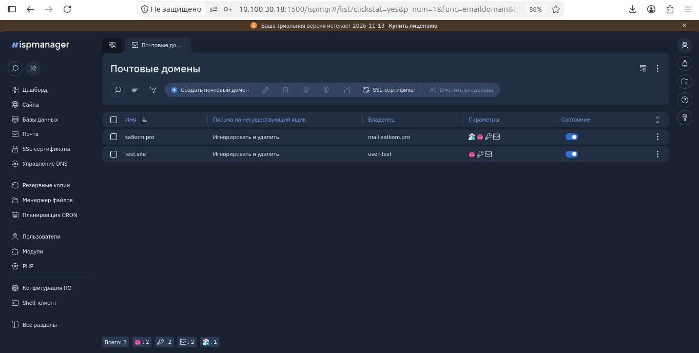
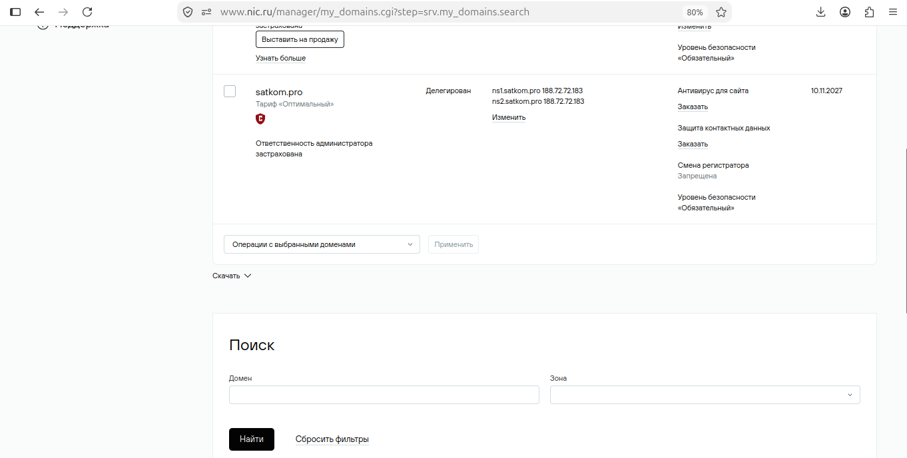
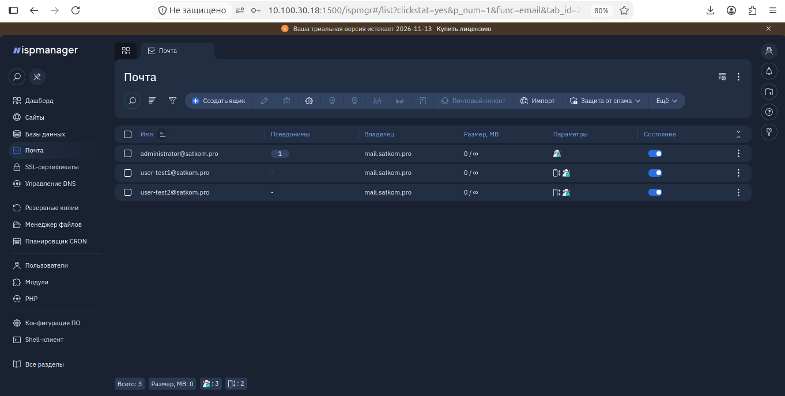
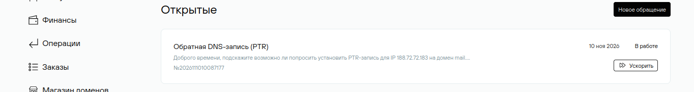
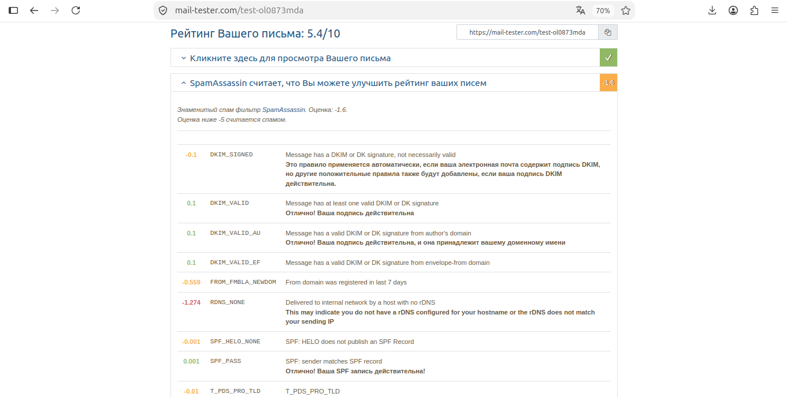
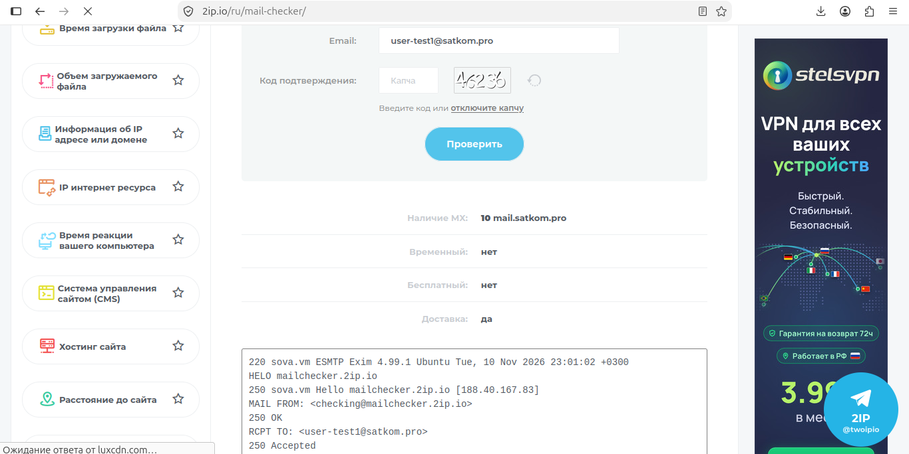
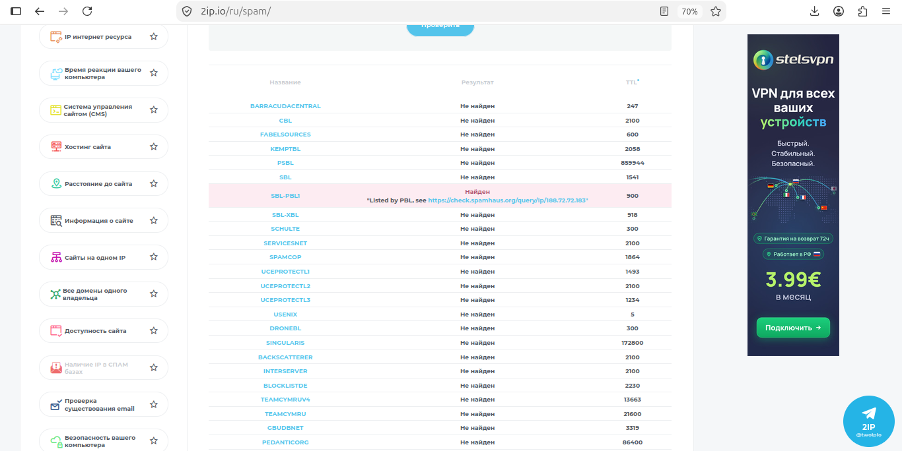
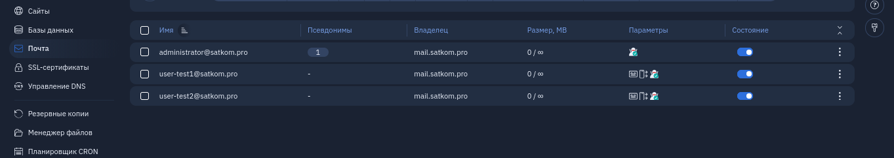
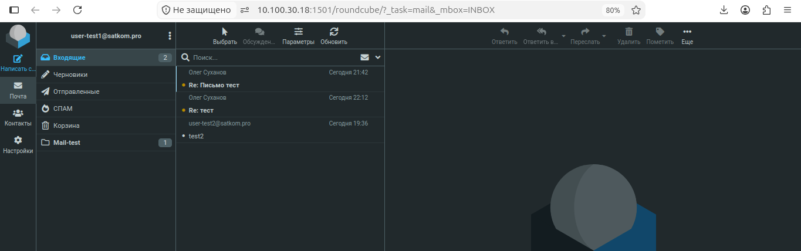
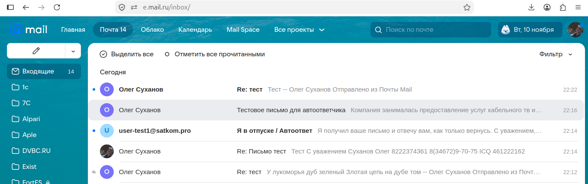

# Практическое задание «Конфигурация почтового сервиса» в ISPmanager выполнил Суханов О.В.

Шаг 1.
Установить все нужные возможности почтового сервера в панели, создать почтовый домен и почтовый ящик.
Итог выполнения шага: скриншот открытого меню панели «Конфигурация ПО».

Шаг 2.
Выполнить все необходимые настройки в панели и на стороне провайдера доменных имён.
Итог выполнения шага: скриншоты открытых меню панели «Почта», «Почтовые домены»
Примечание: Домены можно приобрести у любого регистратора доменных имён (Рег.ру, Руцентр, Бегет или любой другой). В случае, если у вас нет возможности приобрести доменное имя, вы можете воспользоваться инструкциейКак работать с файлом для локального тестирования работы почты.

Шаг 3.
Проверить вашу почту онлайн-инструментами, исправить найденные недочёты.
Итог выполнения шага: Ссылки на итоги проверки выбранным онлайн-инструментом, дублирующий скриншот(ы) страницы этой проверки
Примечание: Если ваш хостинг-провайдер ограничивает исходящий трафик по порту 25 — вы можете протестировать вашу почту локально.

Шаг 4.

Настроить фильтры и автоответчик;
Отправить с личного ящика несколько писем на
ящик вашего почтового сервера;
Получить автоматический ответ;
Проверить работу фильтров.

Итог выполнения шага: Скриншоты меню фильтров, а также скриншоты писем в веб-интерфейсе Roundcube, отфильтрованных по ним, Скриншоты писем, посланных автоответчиком.

## Решение.

### Шаг 1. Установка возможностей почтового сервера, создание домена и ящика

В разделе «Конфигурация ПО» панели ispmanager были установлены и настроены все необходимые компоненты для полноценной работы почты. В состав установленного ПО вошли:

    Почтовый сервер (Exim, Dovecot).

    Антиспам (SpamAssassin).

    Антивирус (ClamAV).

    Модуль DKIM (OpenDKIM).

    Сервер имён (BIND).

    Веб-интерфейс для работы с почтой (Roundcube) и фильтрации (Sieve).

Далее был создан почтовый домен satkom.pro с привязкой к внешнему IP-адресу, включенной проверкой на вирусы, спам и генерацией DKIM-ключа (2048 бит). Внутри домена созданы тестовые почтовые ящики: user-test1@satkom.pro и user-test2@satkom.pro.

### Шаг 2. Настройка панели и стороны провайдера доменных имён

Для полноценной работы почты была выполнена сложная техническая настройка DNS.

Настройка сервера имён (BIND): В панели ispmanager был активирован DNS-сервер BIND. Создана зона satkom.pro, сгенерированы A-записи для хостов ns1 и ns2.

Настройка на стороне регистратора (nic.ru):

В личном кабинете nic.ru были зарегистрированы «Дочерние DNS-серверы» (ns1.satkom.pro и ns2.satkom.pro) с привязкой к IP сервера.

Домен satkom.pro был делегирован на эти серверы.

Почтовые DNS-записи: В зоне satkom.pro созданы все необходимые записи для защиты от спама и корректной маршрутизации:

        MX-запись: указывает на mail.satkom.pro.

        SPF (TXT): v=spf1 ip4:188.72.72.183 ~all (разрешает отправку с нашего IP).

        DKIM (TXT): публичный ключ, сгенерированный панелью.

        DMARC (TXT): v=DMARC1; p=none; aspf=r; sp=none.

SSL-сертификат: В настройках почтового домена  mail.satkom.pro успешно выпущен бесплатный сертификат Let's Encrypt.
Так как установка PTR-записи (обратной DNS-записи)
делается на стороне регистратора, принято решениесоздать заявку на добавления записи, потому как сервер используется постоянно для личных целей.
 

 ### Шаг 3. Проверка почты онлайн-инструментами

Для проверки качества отправляемых писем и корректности DNS-настроек использовался сервис mail-tester.com.
С ящика user-test2@satkom.pro было отправлено тестовое письмо. Сервис проверил его и выдал результат 5.4/10.

Результаты проверки:

SPF: Успешно пройден. Сервер имеет право отправлять почту от имени домена.

DKIM: Подпись действительна, принадлежит домену отправителя.

DMARC: Проверка пройдена успешно.

RDNS_NONE (-1.274): Отсутствует PTR-запись (обратный DNS) для IP 188.72.72.183. Это настройка на стороне хостинг-провайдера, запрос на её установку (IP -> mail.satkom.pro) был отправлен в поддержку.

FROM_FMBLA_NEWDOM (-0.559): Домен satkom.pro зарегистрирован менее 7 дней назад. Это естественное ограничение для новых доменов, которое исчезнет со временем.

SPF_HELO_NONE: Для имени mail.satkom.pro рекомендуется добавить отдельную SPF-запись.

После некоторых исправлений было сделано три проверки на сервисе mail-tester.com и страница заблокировалась без оплаты, остальные тесты были проведены на 2ip.ru.

 ### Шаг 4. Настройка фильтров, автоответчика и тестирование

В панели ispmanager для ящика user-test1@satkom.pro были настроены правила обработки входящей почты.

Автоответчик: Включен автоответчик с темой «Я в отпуске / Автоответ» и текстом приветствия.

Фильтр: Создано правило: если тема письма содержит слово test, письмо автоматически перемещается в специально созданную папку Mail-test.

Тестирование работы:

С каждого ящика user-test1@satkom.pro и user-test2@satkom.pro было отправленно по тестовому письму, и так как все прошло в локальной сети без выхода в интернет, все письма отправились и пришли по адресу моментально, а из вне пришлось добавить проброс портов на роутере на 25 порт и тогда тоже письма пошли на ispmanager.

С внешнего ящика satkom-tv@mail.ru было отправлено письмо на user-test1@satkom.pro. Сервер успешно принял его, проверил антивирусом и отправил автоматический ответ на Mail.ru.

 Второе письмо с темой «test» было успешно перехвачено фильтром и при доставке попало сразу в папку Mail-test (что подтверждается веб-интерфейсом Roundcube).

В ходе выполнения задания был успешно развернут и настроен полноценный почтовый сервер на базе ispmanager. Решены сложные задачи по делегированию домена на собственные NS-серверы, настройке SPF/DKIM/DMARC для высокой доставляемости, а также проверена работа фильтров и автоответчиков. Выявленные в ходе тестирования замечания (отсутствие PTR-записи) связаны с внешними факторами (настройки регистратора) и были взяты в работу.